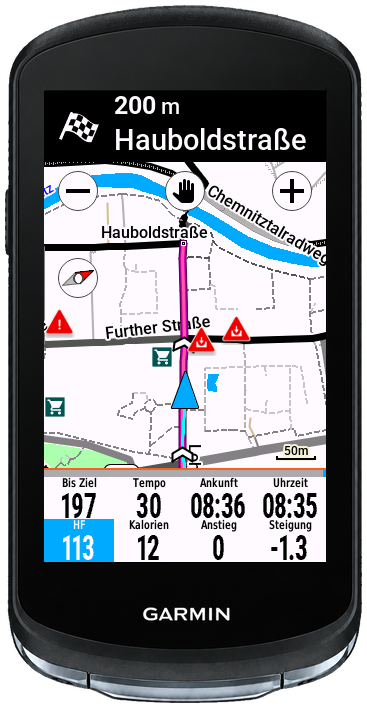

# Ride Dashboard

<h3 align="center">Deine Fahrdaten auf einen Blick, während die Karte sichtbar bleibt.</h3>

  

[English](README.md) | [Deutsch](README-de.md)

Ride Dashboard ist ein kostenloses Garmin-Connect-IQ-Datenfeld für
Radfahrerinnen und Radfahrer, die Aktivitäts- und Sensorwerte neben der
Garmin-Karte sehen möchten.

## Installation

[Ride Dashboard im Garmin Connect IQ Store öffnen](https://apps.garmin.com/de-DE/apps/3fc01697-6230-4efa-b79b-6470ccac4483).

Ride Dashboard unterstützt **Edge 1040**, **Edge 1040 Solar** und **Edge 1050**.
Für den Edge 1050 ist mindestens Ride Dashboard 1.1.0 erforderlich.

Die [Installationsanleitung](installation-de.md) zeigt, wie du die App
synchronisierst, einer Datenseite hinzufügst und direkt am Edge einrichtest.

## Funktionen

- **Fahrdaten selbst auswählen.** Konfiguriere Kacheln für Werte wie Tempo,
  Herzfrequenz, Leistung und Ankunftszeit direkt am Edge.
- **Fahrdaten und Karte gemeinsam sehen.** Platziere das Dashboard in einem
  flachen, breiten Feld unter der Karte oder in einem anderen breiten oder
  halbbreiten Datenfeld.
- **Fortschritt oder Zonen einblenden.** Die Zusatzleiste zeigt den
  Routenfortschritt, die aktuelle Herzfrequenz- oder Leistungszone oder die
  Herzfrequenz-Zonenzeit der laufenden Runde.

## Berechtigungen

Mit der Garmin-Connect-IQ-Berechtigung `UserProfile` liest Ride Dashboard die
Profilwerte für Kennzahlen wie Watt pro Kilogramm, FTP-Prozent und
Herzfrequenzzonen.

## Datenschutz

Ride Dashboard verarbeitet Fahrdaten auf dem Edge und speichert Einstellungen
lokal. Die App überträgt weder Fahrdaten noch Einstellungen.
Weitere Informationen stehen in der [Datenschutzerklärung](privacy-de.md).

## Feedback und Support

Lies die [Hinweise zur Fehlerbehebung](support-de.md) und
[durchsuche vorhandene Issues](https://github.com/felix-lorenz/ride-dashboard-support/issues), bevor du ein neues erstellst.
[Wähle ein Issue-Formular](https://github.com/felix-lorenz/ride-dashboard-support/issues/new/choose) für einen
Fehlerbericht, eine Supportfrage oder einen Funktionswunsch auf Deutsch oder
Englisch.

Die Support-Seiten sind ohne Anmeldung lesbar. Zum Absenden eines Issues ist
ein GitHub-Konto erforderlich. Der Support läuft über öffentliche GitHub Issues.
**Veröffentliche keine privaten Aktivitäts-, Gesundheits- oder Kontodaten,
genauen Standortdaten, FIT-Dateien, vollständigen Aktivitätsexporte oder
vollständigen Logs.** Hänge nur zugeschnittene Bildschirmfotos oder Fotos an,
aus denen du private Informationen entfernt hast.

## Über dieses Repository

Dieses Repository enthält öffentliche Supportinformationen und Issue-Formulare
für Ride Dashboard. Felix Lorenz pflegt den App-Quellcode und die
Veröffentlichungen separat.
