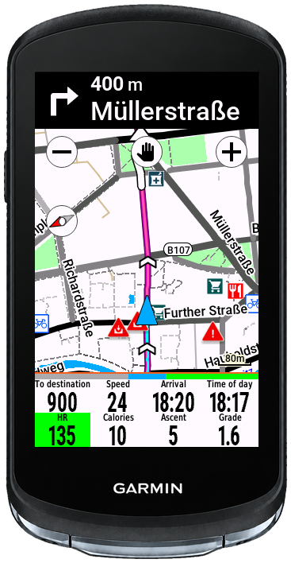

# Ride Dashboard

<h3 align="center">See your ride data at a glance and keep the map in view.</h3>

  

[English](README.md) | [Deutsch](README-de.md)

Ride Dashboard is a free Garmin Connect IQ data field for cyclists who want to
see activity and sensor values alongside Garmin's map.

## Install

[Get Ride Dashboard in the Garmin Connect IQ Store](https://apps.garmin.com/en-US/apps/3fc01697-6230-4efa-b79b-6470ccac4483).

Ride Dashboard supports **Edge 1040**, **Edge 1040 Solar**, and **Edge 1050**.
Edge 1050 support starts with Ride Dashboard 1.1.0.

See the [installation and setup guide](installation-en.md) to sync the app,
add it to a data screen, and configure it on the Edge.

## Features

- **Choose the data you see.** Configure tiles for ride metrics such as speed,
  heart rate, power, and arrival time directly on the Edge.
- **Use the dashboard alongside the map.** Place it in a shallow full-width
  field beneath the map or use another full-width or half-width field.
- **Add a progress or zone strip.** Show route progress, the current heart-rate
  or power zone, or time in heart-rate zones for the current lap.

## Permissions

The Garmin Connect IQ `UserProfile` permission lets Ride Dashboard read the
profile values used for metrics such as watts per kilogram, FTP percentage, and
heart-rate zones.

## Privacy

Ride Dashboard processes ride data on the Edge and stores its settings locally.
It does not transmit ride data or settings. See the [privacy policy](privacy-en.md).

## Feedback and support

Read the [support and troubleshooting guide](support-en.md) and
[search existing issues](https://github.com/felix-lorenz/ride-dashboard-support/issues) before opening a new one.
[Choose an issue form](https://github.com/felix-lorenz/ride-dashboard-support/issues/new/choose) to report a bug,
ask a support question, or request a feature in English or German.

Anyone can read the support pages. A GitHub account is required to submit an
issue. All support happens in public GitHub Issues. **Keep private activity,
health, account, and precise location data, FIT files, complete activity
exports, and complete logs out of public issues.** Only attach cropped
screenshots or photos after removing private information.

## About this repository

This repository contains public support documentation and issue forms for Ride
Dashboard. Felix Lorenz maintains the app source code and release builds
separately.
